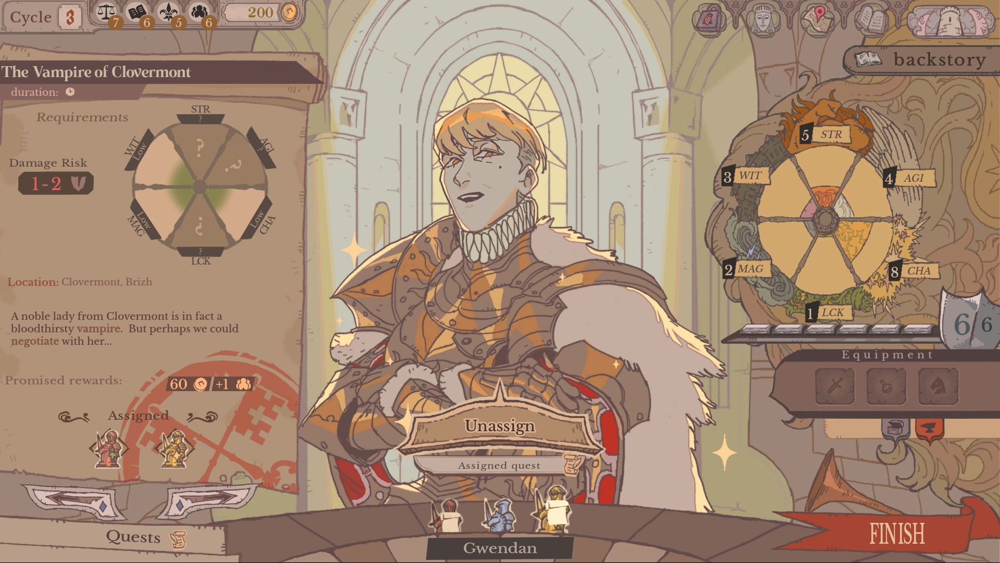
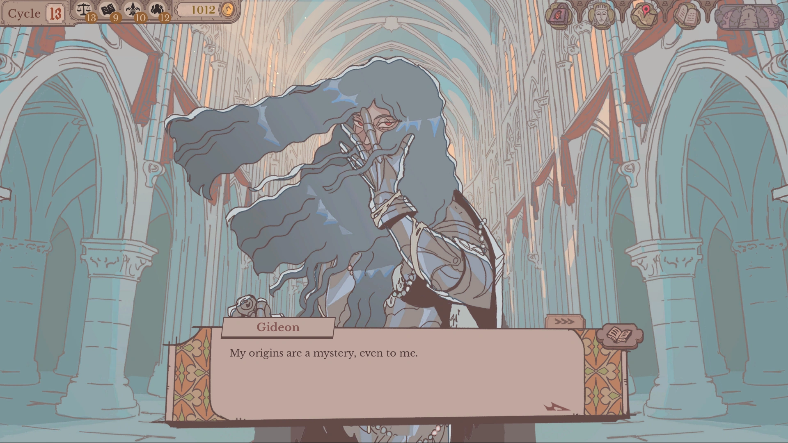
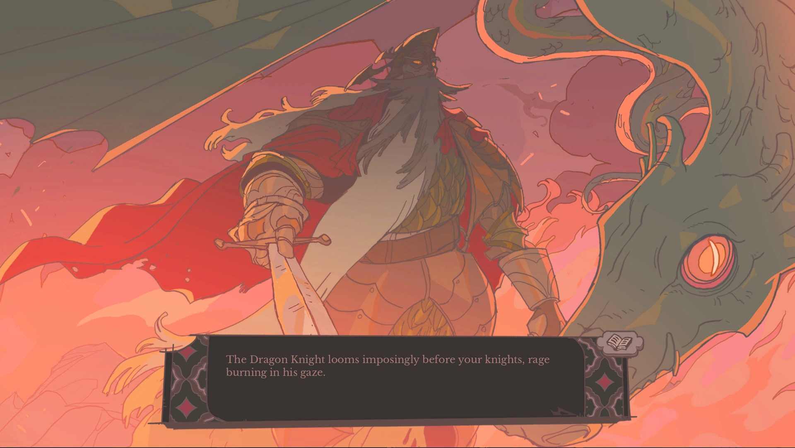
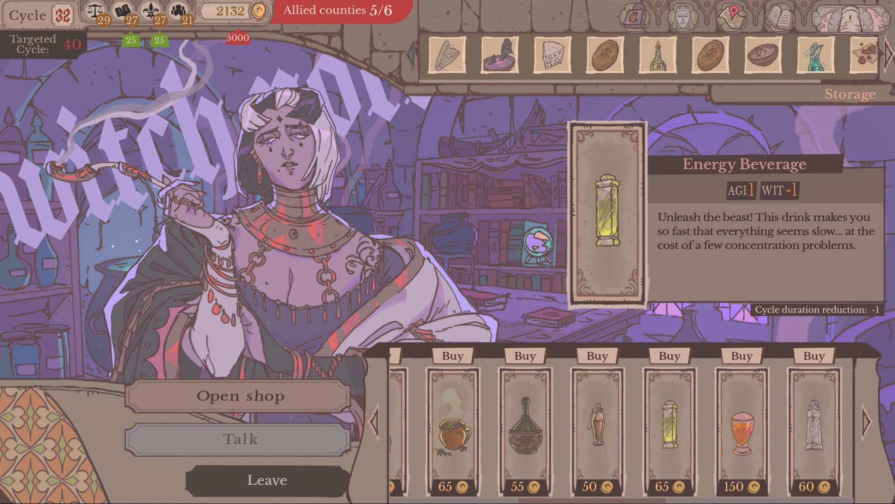
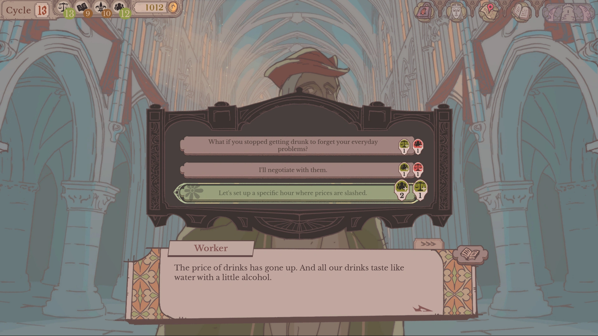

Today, <strong class="paul">Paul Mozet</strong> (Lead Programmer on Sovereign Tower) and <strong class="lisa">Lisa Garnier</strong> (Narrative Design and Technical Artist on Sovereign Tower) from [Wild Wits Games](https://wildwits.games) tell us about their experience developing their latest Godot game: Sovereign Tower.

Sovereign Tower is a story-rich Round Table management RPG where you recruit eccentric Knights, assign quests and balance egos whilst carving out your kingdom's destiny. The game is already out on [Steam](https://store.steampowered.com/app/4113940/Sovereign_Tower/) for Windows and Linux.

<iframe width="560" height="315" src="https://www.youtube.com/embed/aAz_CooIugY" frameborder="0" allowfullscreen style="width: 100%; aspect-ratio: 16 / 9; height: auto;"></iframe>

## Can you tell us a little bit about your game?

<strong class="paul">Paul Mozet (Lead Programmer on Sovereign Tower):</strong> <em>Sovereign Tower</em> is a round table manager RPG, mostly narrative, where you are the new Sovereign of a kingdom. You will have to recruit knights at your round table and dispatch them through the kingdom to answer the grievances of your people and the other counties’ representatives that will come to see you, while managing the ego of all of those eccentric characters. And if anything goes awry, you can count on the demon of the tower to go back in time and try to handle things in a different way!

## How did you get your start in game development? And how did it grow into a full-time position?

<strong class="paul">Paul:</strong> A composer friend of mine, Pierrick Veillerobe, motivated me to do a Ludum Dare game jam with him while I was studying computer science back in 2021. I loved the experience and we made a few more in the year after. At the same time, I had the opportunity to meet Corto and François, the founders of Wild Wits Games and they welcomed me in 2022 to do a two months internship as a programmer on Aetheris, the first game of the studio. As the internship went well, they offered me a full-time position at the studio, as a programmer, an offer that I immediately accepted.

<strong class="lisa">Lisa Garnier (Narrative Design and Technical Artist on Sovereign Tower):</strong> I first started exploring interactive media while I was at art school, graduating in 2020. I then switched to a computer science program to develop more technical skills. Like Paul, I joined the team in 2023 after completing a few-month internship. For our previous projects, <em>Aetheris</em> and <em>Crown Gambit</em>, I worked in a technical art role, which suited me well given my background in art and computer science. 
<em>Sovereign Tower</em> is the first project I've worked on as a narrative designer, which is something I've wanted to do for a long time!

## What were some of the biggest challenges you faced during the development process, and how did you overcome them?

<strong class="paul">Paul:</strong> The biggest one I think about is the rewind mechanic. We needed to have two saves per played cycle, one for the morning and one for the afternoon, which should all remember the state of all previously played cycles. But it couldn't be simple state saves as using the demon power is not simply going back to a previous state, as the Sovereign remembers all information they get. Add to that hundreds of narrative variables and quests and more than a hundred characters, and you'll get the perfect bug factory! To overcome the issue, we split everything we needed to save as much as we could to be as precise as possible, and had to do a lot of testing. But even so, some issues slipped through at the release, which wasn't a big surprise and we're fixing those as fast as we can.

<strong class="lisa">Lisa:</strong> When it comes to the story, one of our biggest challenges was keeping the scope under control in terms of word count and budget. 
One of the things that makes <em>Sovereign Tower</em> so interesting and worth playing more than once is all the different ways the story can go, which play around with the time rewind mechanics. We always want to take these as far as we can to make the experience as interesting and cohesive as possible, but adding new time-rewind options to every little interaction just wasn't realistic.
Game localization is expensive, and as a small studio, every word counts. We spent ages talking about and rethinking our main story ideas, and once most of the content had been written, we had to cut out the extra bits: getting rid of some of the variations here and there and scaling back some of our ambitions, while making sure these changes weren't too big to impact the player experience. It was a bit of a balancing act, and there were a few stressful moments during production when we really worried we'd have to throw away a lot of the story.

## How did you come up with game design elements for your project, such as the time rewinding mechanic? Were there any game design changes based on iteration and playtesting?

<strong class="paul">Paul:</strong> The rewinding mechanic came up pretty early in the project conception, as we wanted to encourage players to explore the different narrative options the game was offering, so they would want to start a new playthrough right after finishing the first one. We already made a heavy narrative game with Crown Gambit, so we knew an incentive to dwell in the different paths would add a lot to the experience. For the rest of the core loop, it didn't change a lot since the beginning of the conception to be honest. Of course, through playtesting we found a lot of quality of life features that we implemented, and others were requested by players and have been added in the game after the release. Also, even if we started working on Sovereign Tower before learning about the project, the release of Dispatch made us rethink a few things. The best example is the implementation of the level and experience system for the knights, which we felt was mandatory after finishing Dispatch. We also made a few adjustments to the knights' tags system to make it more understandable.

## How did you create the various character designs for your game? What were your sources of inspiration? How did you write character dialogues?

<strong class="lisa">Lisa:</strong> Our art and creative director Gobert was often the starting point for our character designs from a visual perspective. He's full of ideas and he's always coming up with these really distinctive concepts he's eager to explore, whether it's more fantastical ideas like a wolf-knight inspired by the Beast of Gévaudan (Rufus) or a mermaid knight (Ligia), or more caricature-driven concepts, like the overworked salaryman (Oliver) or the insufferable rich kid (Gwendan). 
His inspirations are pretty diverse, but there’s obviously a lot of medieval fantasy, pop culture, and Arthurian legend in the mix, which is also a big part of our fantasy world’s identity. These visual ideas often came together with character archetypes we wanted to explore, in terms of personality type: the shy one, the dominant one, the cursed one, and so on. 
Early in development, we put together a huge collaborative board where we threw all kinds of ideas around, almost like a giant moodboard we could draw from later when fleshing out individual characters. We wanted each character to have a strong, immediately recognizable archetype, a bit like the cast of <em>Ace Attorney</em>, where every character has their own distinct personality and quirks. 
It was a very collaborative process. While some characters were already clear from the start, others needed more discussion and refinement to make sure their characterisation felt in line with their design. 
Once the characters were well-defined, with distinct personalities and clear character arcs, writing their dialogue was generally pretty straightforward and fun! Giving each of them their own way of speaking and little quirks also helped a lot, providing a clear direction and letting their voice naturally shape the writing. Of course, it still took a few iterations to get everything to the right level of quality, but overall, the process flowed really well, and bringing all these characters to life was a real pleasure.

## In reviews, your game is regularly praised for its art direction. How did you handle the asset pipeline with Godot? Do you have any suggestions for improvement in this regard?

<strong class="lisa">Lisa:</strong> For assets that were relatively straightforward to integrate (such as character portraits) Gobert would upload them to our repository and update them in Godot when needed. For more complex integrations (particularly UI elements) Paul or I would take over. Godot’s scene system made it really easy to organize and integrate assets, while also giving Gobert the flexibility to tweak and adjust things himself as we moved into the visual polish phase. This allowed him to iterate on the game’s visuals without having to go through a developer for every small change. 
As for potential improvements, I don't have any major suggestions based on our experience. The workflow felt intuitive for our needs, and overall the pipeline worked well for the scope of our project.

## How did you animate scenes and UI elements in your project with Godot? What was your experience with Godot’s animation system, and do you have any ideas for improvement?

<strong class="lisa">Lisa:</strong>  We used a fairly even mix of AnimationPlayers and Tweens depending on the needs of each scene. I find both systems very complete and intuitive to work with, and I always enjoy writing a little tween with some juicy easing curves. 
Animating UI nodes could be a bit tricky at the time as it often required little workarounds to animate them smoothly, given how constrained their transforms were by the UI layout system. Thankfully this became much easier with Godot 4.7 and the introduction of transform offsets making it far more straightforward to animate UI elements for small transitions.

## How did you discover Godot? What made you pick it for your project?

<strong class="paul">Paul:</strong> I first learned game development with Unity, around 2020, mostly with Brackeys' tutorials. I learned about Godot through game jams, as I've seen quite a few games made with it back then but I didn't look into it at that time. What made me switch to it was that Wild Wits was using it for Aetheris, so we can say I switched to Godot because of a job opportunity. Which wasn't that common back in 2022!

<strong class="lisa">Lisa:</strong> I was first introduced to Godot during my computer science studies, and I later used it for game jams at the same school. I immediately found it very intuitive, and GDScript was also quite easy to pick up. I was also instantly charmed by its goofy little robot logo.

## What do you like about Godot?

<strong class="paul">Paul:</strong> It's easy to use, it's open source, we own what we make with it. But mostly I think that I really enjoy the community around Godot. When I started with Unity, I loved to see that many creators making tutorials and all the activity on the forums. With Godot, I'm finding that energy again. I really like the idea of an engine made by the community that is friendly for beginners but at the same time is very good for professionals too.

<strong class="lisa">Lisa:</strong> It’s open source and really easy to get the hang of!

## While making your game, were there any features that you would have liked to see in Godot?

<strong class="paul">Paul:</strong> I must admit that there is only one thing I still miss from my days on Unity, and it's the possibility to have multiple files systems and inspectors tabs and locking them. I'd love to see it on Godot one day!

## What advice would you give to aspiring game developers who are just starting out in the field?

<strong class="paul">Paul:</strong> First, if you haven't, try to do at least one game jam. You can find online game jams almost every week on itch.io and it will confront you to some of the various challenges of video game development, especially finishing a project. It's a good way to know if you'll enjoy game dev or not. A second advice I would give is don't let impostor syndrome prevent you from grabbing a serious opportunity if it presents itself. The industry is in a dire state currently, and finding a place in it requires having some skills, of course, but it also requires being lucky. I was. So when a chance comes up, don't let it slip! I'll just assume that you should follow this advice only if you don't endanger yourself financially. Also if you want to work in indie game dev, accept to work on different domains at once. When you are a team of four or five people making a game, you can't expect to only do one thing, so try to be what the project might need, not only what you have on your diploma.

<strong class="lisa">Lisa:</strong> I’d encourage you to take risks and try things that are a bit daring, because I think creativity is never at its best until it ends up surprising even ourselves. As Paul mentioned, game jams are incredible opportunities for experimentation in this regard, and I think it’s also important to make the most of them to occasionally create situations that take us completely out of our comfort zone and to broaden our sources of inspiration and references. You might end up creating something that feels truly your own.

---

Thank you very much Paul and Lisa for taking the time to answer our questions, and we look forward to see what you do next with Godot!

If you want to play Sovereign Tower, it is available on [Steam](https://store.steampowered.com/app/4113940/Sovereign_Tower/) for Windows and Linux.
