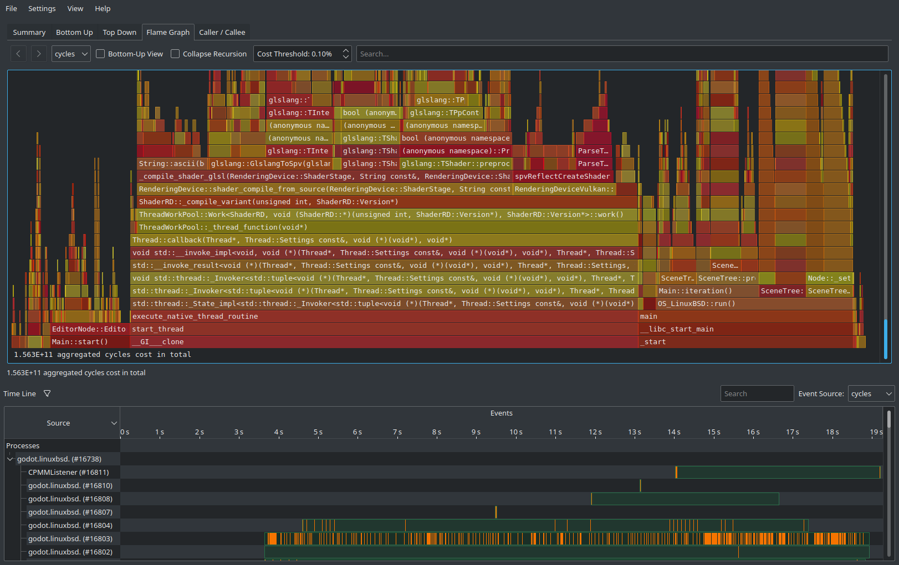

Nobody likes running into a crash when playing their favorite game. Despite that, crashes are still a part of game development. From a developer's perspective, being able to act quickly on crash reports is essential to ensure a good player experience.

Until now, debug symbols for official releases were only [available on Android](https://docs.godotengine.org/en/latest/tutorials/platform/android/resolving_crashes_on_android.html) for use with Google Play. This allowed developers to obtain usable backtraces from <abbr title="Application Not Responding">ANR</abbr> reports, which is important as high ANR rates will penalize an application's ranking on Google Play. However, developers targeting other platforms still had to compile custom builds (and distribute them to players) to get usable crash backtraces.

With Godot 4.8, official builds finally provide separate debug symbols on all supported platforms.

Providing debug symbols also has other benefits, such as allowing C++ profilers to provide useful information.

***Note:** This article refers to "crashes" as engine crashes from Godot's C++ code. Script errors from GDScript or C# are not covered by this change, and are already debuggable even in builds without debug symbols included.*

## What are debug symbols, and what are they useful for?

When C++ code is compiled into a binary, information such as function names is normally lost. This reduces binary size, but it also makes debugging much more difficult.

Debug symbols contain function names, parameter names, and sometimes additional information such as local variable names. For large projects like Godot, this information can weigh hundreds of MBs when uncompressed (much larger than the binary itself). When the debug symbols are embedded in the binary (which is how it has historically worked on most platforms), the resulting binary can be over 1 GB in size! This is why until now, debug symbols haven't been distributed with Godot's official releases.

To resolve this, we've had to perform two tasks:

- Add support for separating debug symbols into a separate file from the binary. This makes distribution more flexible, as debug symbols can be downloaded only when needed. This way, it's even possible for a project to download its own debug symbols on demand.

The main situation where debug symbols are useful are for crash reports. These come in the form of *backtraces*, which pinpoint the function in which the crash occurred as well as every other function that was called to get to the point of the function causing the crash.

We'll use the [Custom Logging demo](https://store.godotengine.org/asset/godot-foundation/custom-logging-demo/) for this example. This demo project has a button that [crashes the engine on purpose](https://docs.godotengine.org/en/stable/classes/class_os.html#class-os-method-crash) when called, which is useful for testing the crash handler.

Without debug symbols, the crash backtrace will list the same number of functions, but function and parameter names are not available:

```
================================================================
handle_crash: Program crashed with signal 4
Engine version: Godot Engine v4.8.beta.custom_build (e810f3f7af27a7d3915b0f6f04d89d3c6f195a0b)
Dumping the backtrace. Please include this when reporting the bug on: https://github.com/godotengine/godot/issues
Load address: 5591b822c000

[1] 7fb950073fb0 (libc.so.6+19fb0) - /lib64/libc.so.6(+0x19fb0) [0x7fb950073fb0]
[2] 5591bd0ea7be (main+4ebe7be) - godot-strip(+0x4ebe7be) [0x5591bd0ea7be]
[3] 5591b8c364bc (main+a0a4bc) - godot-strip(+0xa0a4bc) [0x5591b8c364bc]
[4] 5591b8affc59 (main+8d3c59) - godot-strip(+0x8d3c59) [0x5591b8affc59]
[5] 5591bd7b1adf (main+5585adf) - godot-strip(+0x5585adf) [0x5591bd7b1adf]
[6] 5591bd4483d5 (main+521c3d5) - godot-strip(+0x521c3d5) [0x5591bd4483d5]
[7] 5591bd7d2788 (main+55a6788) - godot-strip(+0x55a6788) [0x5591bd7d2788]
[8] 5591bb5aa90c (main+337e90c) - godot-strip(+0x337e90c) [0x5591bb5aa90c]
[9] 5591bb56f47b (main+334347b) - godot-strip(+0x334347b) [0x5591bb56f47b]
[10] 5591bb599569 (main+336d569) - godot-strip(+0x336d569) [0x5591bb599569]
[11] 5591bb4d3e4a (main+32a7e4a) - godot-strip(+0x32a7e4a) [0x5591bb4d3e4a]
[12] 5591bb5045b2 (main+32d85b2) - godot-strip(+0x32d85b2) [0x5591bb5045b2]
[13] 5591bb505f37 (main+32d9f37) - godot-strip(+0x32d9f37) [0x5591bb505f37]
[14] 5591bb568228 (main+333c228) - godot-strip(+0x333c228) [0x5591bb568228]
[15] 5591b831d87d (main+f187d) - godot-strip(+0xf187d) [0x5591b831d87d]
[16] 5591b8337a60 (main+10ba60) - godot-strip(+0x10ba60) [0x5591b8337a60]
[17] 5591bd3e495f (main+51b895f) - godot-strip(+0x51b895f) [0x5591bd3e495f]
[18] 5591bd3e5fef (main+51b9fef) - godot-strip(+0x51b9fef) [0x5591bd3e5fef]
[19] 5591b832ea4a (main+102a4a) - godot-strip(+0x102a4a) [0x5591b832ea4a]
[20] 5591b8300465 (main+d4465) - godot-strip(+0xd4465) [0x5591b8300465]
[21] 5591b828c33b (main+6033b) - godot-strip(+0x6033b) [0x5591b828c33b]
[22] 7fb95005d681 (libc.so.6+3681) - /lib64/libc.so.6(+0x3681) [0x7fb95005d681]
[23] 7fb95005d798 (libc.so.6+3798) - /lib64/libc.so.6(__libc_start_main+0x88) [0x7fb95005d798]
[24] 5591b82eebf5 (main+c2bf5) - godot-strip(+0xc2bf5) [0x5591b82eebf5]
-- END OF C++ BACKTRACE --
================================================================
GDScript backtrace (most recent call first):
    [0] _on_crash_engine_pressed (res://main.gd:59)
-- END OF GDSCRIPT BACKTRACE --
================================================================
```

When using a build that has debug symbols available, the same crash backtrace will look like this instead:

```
================================================================
handle_crash: Program crashed with signal 4
Engine version: Godot Engine v4.8.beta.custom_build (e810f3f7af27a7d3915b0f6f04d89d3c6f195a0b)
Dumping the backtrace. Please include this when reporting the bug on: https://github.com/godotengine/godot/issues
Load address: 55e2fa6fd000

[1] 7f7336c66fb0 (libc.so.6+19fb0) - /lib64/libc.so.6(+0x19fb0) [0x7f7336c66fb0]
[2] 55e2ff5bb7be (main+4ebe7be) - CoreBind::OS::crash(String const&) at core/core_bind.cpp:354
[3] 55e2fb1074bc (main+a0a4bc) - GDScriptLanguage::get_singleton() at modules/gdscript/gdscript.h:584
[4] 55e2fafd0c59 (main+8d3c59) - GDScriptInstance::callp(StringName const&, Variant const**, int, Callable::CallError&) at modules/gdscript/gdscript.cpp:1977
[5] 55e2ffc82adf (main+5585adf) - Object::callp(StringName const&, Variant const**, int, Callable::CallError&) at core/object/object.cpp:885
[6] 55e2ff9193d5 (main+521c3d5) - Variant::clear() at core/variant/variant.h:320
[7] 55e2ffca3788 (main+55a6788) - Object::emit_signalp(StringName const&, Variant const**, int) [clone .part.0] at core/object/object.cpp:1368
[8] 55e2fda7b90c (main+337e90c) - Variant::~Variant() at core/variant/variant.h:882
[9] 55e2fda4047b (main+334347b) - Ref<InputEvent>::operator->() const at core/object/ref_counted.h:122
[10] 55e2fda6a569 (main+336d569) - Ref<InputEvent>::unref() at core/object/ref_counted.h:204
[11] 55e2fd9a4e4a (main+32a7e4a) - Viewport::_gui_call_input(Control*, Ref<InputEvent> const&) at scene/main/viewport.cpp:1780
[12] 55e2fd9d55b2 (main+32d85b2) - Ref<InputEvent>::~Ref() at core/object/ref_counted.h:227
[13] 55e2fd9d6f37 (main+32d9f37) - Ref<InputEvent>::~Ref() at core/object/ref_counted.h:227
[14] 55e2fda39228 (main+333c228) - Ref<InputEvent>::unref() at core/object/ref_counted.h:204
[15] 55e2fa7ee87d (main+f187d) - Variant::~Variant() at core/variant/variant.h:882
[16] 55e2fa808a60 (main+10ba60) - Variant::~Variant() at core/variant/variant.h:882
[17] 55e2ff8b595f (main+51b895f) - __gthread_mutex_lock(pthread_mutex_t*) at /usr/include/c++/16/x86_64-redhat-linux/bits/gthr-default.h:795
[18] 55e2ff8b6fef (main+51b9fef) - Ref<InputEvent>::unref() at core/object/ref_counted.h:204
[19] 55e2fa7ffa4a (main+102a4a) - LocalVector<_XEvent, unsigned int, false, false>::~LocalVector() at core/templates/local_vector.h:425
[20] 55e2fa7d1465 (main+d4465) - OS_LinuxBSD::run() at platform/linuxbsd/os_linuxbsd.cpp:1022
[21] 55e2fa75d33b (main+6033b) - main at platform/linuxbsd/godot_linuxbsd.cpp:122
[22] 7f7336c50681 (libc.so.6+3681) - /lib64/libc.so.6(+0x3681) [0x7f7336c50681]
[23] 7f7336c50798 (libc.so.6+3798) - /lib64/libc.so.6(__libc_start_main+0x88) [0x7f7336c50798]
[24] 55e2fa7bfbf5 (main+c2bf5) - /home/hugo/.local/bin/godot(+0xc2bf5) [0x55e2fa7bfbf5]
-- END OF C++ BACKTRACE --
================================================================
GDScript backtrace (most recent call first):
    [0] _on_crash_engine_pressed (res://main.gd:59)
-- END OF GDSCRIPT BACKTRACE --
================================================================
```

This is much more informative, and provides sufficient information to help resolve a crash.

Debug symbols can either be embedded in the Godot binary, or they can be separate. For official releases, debug symbols are always separate. This allows you to download debug symbols only if you need them.

## How to export and distribute a project with debug symbols

Due to their large size, debug symbols are not automatically downloaded by default when installing export templates. They can be downloaded separately for each platform and architecture in the Manage Export Templates dialog (TODO).

To export a project with debug symbols, make sure the **Debug > Export Debug Symbols** option is set to the desired value. It's set to **Debug Only** by default, which means that projects exported with **Export with Debug** unchecked will not include debug symbols alongside the binary. To export in release mode with debug symbols, you'll need to set it to **Debug & Release**.

TODO

## Other benefits of debug symbols

debug symbols aren't just useful for crash reports. They also allow [*sampling profilers*](https://docs.godotengine.org/en/stable/engine_details/development/profiling/#sampling-profilers) to work.

Sampling profilers periodically interrupt the running program and take a "sample", which records which functions are running. Using this information, the profiler estimates which functions the program spent the most time in. This kind of profiler
is more advanced compared to Godot's built-in profiler, as it can also show the time spent in the engine's own C++ functions (instead of being limited to script functions and rough categories for each engine area). This can make it helpful to find CPU bottlenecks that the built-in profiler may miss.

Here is an example of the sampling profiler HotSpot running on Linux, displaying a [flame graph](https://www.brendangregg.com/flamegraphs.html) to visualize which functions took the most time to run:



Note that [*tracing profilers*](https://docs.godotengine.org/en/stable/engine_details/development/profiling/index.html#tracing-profilers) still require custom builds to function, as they rely on code that is disabled in official builds.

## Future work

There is more work in the pipeline for improving the crash handling experience, which didn't make it in Godot 4.8. One such example is [displaying a dialog when a project crashes](https://github.com/godotengine/godot/pull/61906), as currently, the project window closes with no feedback when it crashes. Another example would be [colored crash backtraces for better readability](https://github.com/godotengine/godot/pull/33505).

Another future planned improvement is to [provide a compact Base64 representation of the crash backtrace in the crash message](https://github.com/godotengine/godot/pull/124394). The purpose of this system is twofold: first, it provides a way to share the crash backtrace in a single line. But most importantly, it allows the crash backtrace to be *symbolicated* (or retraced) locally. This means that even if a player does not have debug symbols available at the time of crashing, the developer can perform a retrace of the crash locally using the same binary with debug symbols available. This means players no longer need to have debug symbols installed on their device in most cases, which reduces the game's installed file size.

## References

- [Pull request adding support for exporting debug symbols for Windows and Linux](https://github.com/godotengine/godot/pull/114924)
- [Pull request adding support for exporting debug symbols for macOS](https://github.com/godotengine/godot/pull/122874)
- [Pull request adding support for releasing debug symbols in the official build scripts](https://github.com/godotengine/godot-build-scripts/pull/103)
- [Pull request adding debug symbols to the export template manager](https://github.com/godotengine/godot/pull/124440)

## Support

Godot is a non-profit, open-source game engine developed by hundreds of contributors in their free time, as well as a handful of part or full-time developers hired thanks to [generous donations from the Godot community](https://fund.godotengine.org/). A big thank you to everyone who has contributed [their time](https://github.com/godotengine/godot/blob/master/AUTHORS.md) or [their financial support](https://github.com/godotengine/godot/blob/master/DONORS.md) to the project!

If you'd like to support the project financially and help us secure our future hires, you can do so using the [Godot Development Fund](https://fund.godotengine.org/) platform managed by [Godot Foundation](https://godot.foundation/). There are also several [alternative ways to donate](/donate) which you may find more suitable.
